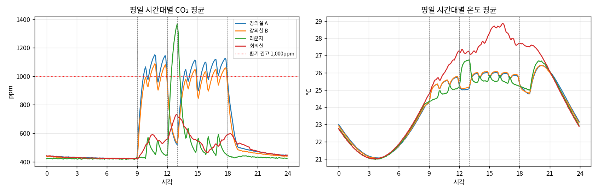
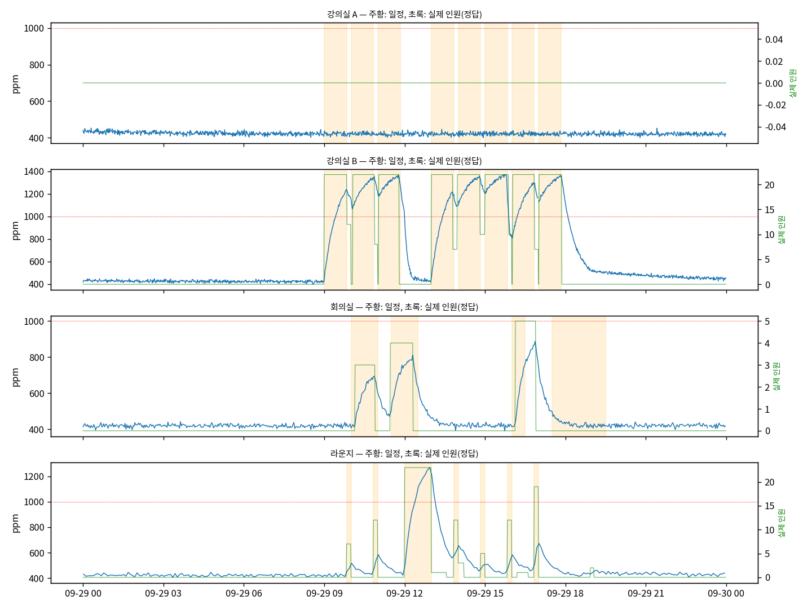
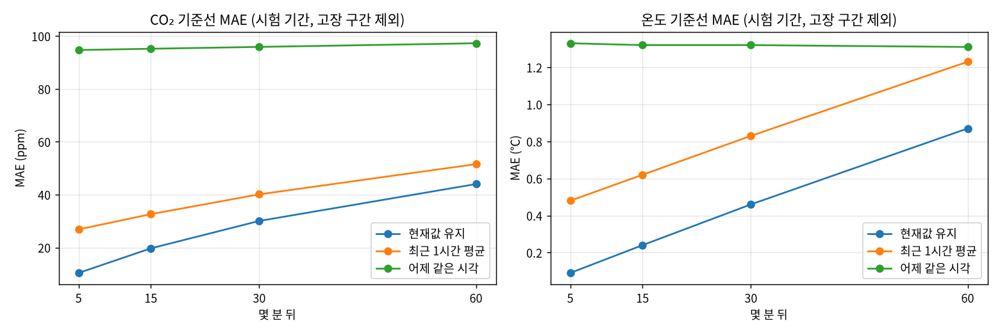

[← 전체 목차](../README.md)

# 과제 2. 데이터 이해와 기준선

## 해결한 것

1. **정제 규칙**을 여섯 가지로 정했다. 학습과 서비스가 같은 코드(`prep.py`)를 쓴다.

   1. 실제로 나올 수 없는 값(CO₂ 300ppm 미만·5,000ppm 초과, 온도 -10℃ 미만·50℃ 초과, 습도 0~100% 밖)은 빈칸으로 바꾼다. 바깥 공기의 CO₂가 약 420ppm이라 실내가 300ppm보다 낮을 수 없고, 0ppm·65535ppm은 센서 오류 값이다. 이런 값이 하나만 섞여도 그 5분 평균이 수백 ppm 틀어진다. 지우지 않고 빈칸으로 두면 3번 규칙이 처리한다. (합성 6주에서 CO₂ 75건, 온도 83건)
   2. 센서에서 들어오는 값을 5분씩 묶어 평균을 낸다. 예를 들어 10:01~10:05의 평균을 “10:05 값”으로 부른다. 묶음에 끝나는 시각의 이름을 붙이기 때문에, “10:05 값”에는 10:05까지 이미 들어온 값만 들어 있다. 센서마다 값을 보내는 주기가 다르다(강의실 1분, 회의실 2분, 라운지 5분). 5분으로 묶으면 가장 느린 라운지도 칸마다 값이 하나씩 들어가고, 60분 예측도 5분 간격이라 단위가 맞는다. 1분마다 보내는 센서는 5분 칸에 값이 5개 들어가, 평균을 내면 측정 흔들림이 절반 아래로 줄어든다(합성 데이터 기준 8ppm → 3.6ppm).
   3. 값이 빠진 구간이 15분 이하면 앞뒤 값을 이어서 메우고, 메운 값이라는 표시를 붙인다. 15분보다 길게 빠지면 메우지 않고 빈칸으로 둔다. 실제 값을 일부러 지우고 메워 보니, 15분 빈칸은 오차가 8~10ppm(평일 낮 14~19ppm)이었지만 30분이면 평일 낮 22~37ppm, 60분이면 40~69ppm으로 커졌다. 10분과 15분은 메워지는 빈칸 비율이 거의 같고(93~99% vs 95~100%) 오차 차이도 작다. 30분부터는 오차가 두 배 가까이 커지므로, 그 직전인 15분을 기준으로 했다.
   4. 센서가 여러 대인 공간(실습실 8대, 사무실 2대)은 센서마다 값을 따로 정리한 뒤 평균을 낸다. 그냥 평균을 내면 5분 칸마다 들어온 센서가 바뀌어 값이 괜히 오르내린다(아래 예시 표). 센서별로 정리하자 실데이터에서 “5분 뒤에도 그대로” 예측의 온도 오차가 0.07℃에서 0.02℃로 줄었다.
   5. 값의 크기를 맞추는 정규화(평균을 빼고 표준편차로 나누기)는 학습 기간 데이터로만 계산한다. 시험 기간까지 넣으면 미래 정보가 학습에 섞이기 때문이다.
   6. 튄 값이나 멈춰서 같은 값만 보내는 고장은 여기서 지우지 않는다. 정상 범위 안의 값이라 앞뒤 흐름을 봐야 고장인지 알 수 있고, 이걸 찾는 것이 과제 4의 일이다. 여기서 지우면 탐지기가 고장을 잡는지 시험할 수 없다.
2. **분석 간격은 5분**으로 정했다. 1분을 그대로 쓰면 2분·5분마다 보내는 센서는 칸의 50~80%가 비어, 대부분을 빈칸 처리해야 한다. 반대로 10분 이상으로 묶으면 수업 시작 뒤 CO₂가 오르는 모습(보통 1.5~8분 안에 반응)이 뭉개진다. 5분은 모든 센서가 칸마다 값을 갖고 반응도 1~2칸 안에 잡히는 가장 짧은 간격이다.
3. **학습·검증·시험은 시간 순서대로** 나눴다(학습 4주 → 검증 1주 → 시험 1주). 무작위로 섞으면 안 되는 이유는 세 가지다. 이웃한 5분 칸끼리 값이 거의 같아서, 섞으면 시험 칸 바로 옆 칸이 학습에 들어가 모델이 “옆 칸을 외워” 점수가 부풀려진다. 60분 뒤를 맞히는 문제라 학습 샘플의 정답이 시험 샘플의 입력과 겹친다. 실제 운영에서도 항상 과거로 학습하고 미래를 예측한다.
4. **데이터를 진단**했다(아래 표).

   - 빠진 값은 대부분 게이트웨이가 2~12분 끊긴 것이다. 남는 빠진 값은 공간마다 1~3번 있는 몇 시간짜리 끊김뿐이다. 라운지는 5분마다 보내서 메시지 하나만 빠져도 칸이 통째로 빈다.
   - 평일 시간대별 패턴에 수업·점심·퇴실이 그대로 보인다. 강의실은 9시에 420→1,000ppm까지 오르고, 점심에는 강의실이 떨어지고 라운지가 1,370ppm까지 오른다. 18시 이후 강의실은 1시간 안에 500ppm으로 떨어진다.
   - 일정이 바뀐 뒤 CO₂는 강의실에서 오를 때 1.5~3분, 내려갈 때 5~6분 만에 반응한다. 회의실은 8분으로 가장 느리고 들쑥날쑥하다(예약보다 늦게 오고 인원이 2~8명).
   - 일정과 실제가 어긋난 날: 휴강 5일을 CO₂로 찾았고 모두 맞았다. 회의실 노쇼는 19건으로 추정해 진짜 10건을 모두 잡았지만, 9건은 직전 회의가 끝나 CO₂가 이미 높아서 오르지 않은 경우를 노쇼로 잘못 봤다.
5. **기준선 3가지**(현재값 유지, 최근 1시간 평균, 어제 같은 시각)의 5·15·30·60분 뒤 오차를 재다(아래 표). 가장 강한 것은 현재값 유지다.

**정제 규칙 4번 예시** (센서 A는 늘 23.0℃, B는 늘 23.4℃로 재는 경우)

| 5분 칸 | 들어온 센서 | 그냥 평균 (℃) | 센서별 정리 (℃) |
|---|---|---|---|
| 10:05 | A만 | 23.0 | A 23.0 + B 23.4(직전 값) → 23.2 |
| 10:10 | B만 | 23.4 | A 23.0(직전 값) + B 23.4 → 23.2 |
| 10:15 | A, B | 23.2 | 23.2 |

**4번 빠진 값·이상값 진단** (합성 데이터 6주치)

| 공간 | 보내는 주기 | 메시지 수신률 | 5분 칸 빈칸 비율 (메우기 전 → 후) | 지운 이상값 (CO₂ / 온도) | 가장 길게 빠진 구간 |
|---|---|---|---|---|---|
| 강의실 A | 1분 | 98.9% | 0.8% → 0.6% | 33 / 26 | 350분 |
| 강의실 B | 1분 | 99.1% | 0.6% → 0.4% | 26 / 33 | 225분 |
| 회의실 | 2분 | 99.2% | 0.6% → 0.4% | 12 / 17 | 215분 |
| 라운지 | 5분 | 98.3% | 1.8% → 1.2% | 4 / 7 | 320분 |

**5번 기준선 오차** (MAE, 시험 기간)

| 데이터 · 대상 | 몇 분 뒤 | 현재값 유지 | 최근 1시간 평균 | 어제 같은 시각 |
|---|---|---|---|---|
| 합성 CO₂ (ppm) | 5 / 15 / 30 / 60 | **10.4 / 19.7 / 30.1 / 44.0** | 26.9 / 32.6 / 40.1 / 51.6 | 94.7 / 95.2 / 95.9 / 97.3 |
| 합성 온도 (℃) | 5 / 15 / 30 / 60 | **0.09 / 0.24 / 0.46 / 0.87** | 0.48 / 0.62 / 0.83 / 1.23 | 1.31 / 1.31 / 1.31 / 1.30 |
| 실데이터 CO₂ (ppm) | 5 / 15 / 30 / 60 | **7.6 / 14.5 / 27.2 / 46.4** | 23.8 / 30.0 / 42.9 / 60.8 | 122.4 / 122.3 / 135.0 / 135.1 |
| 실데이터 온도 (℃) | 60 | **0.13** | 0.18 | 0.50 |

*측정 조건: 합성 시험 2026-10-05 ~ 10-11, 실데이터 시험 10-06 ~ 10-20, 같은 평가 지점(합성 60분 6,046개). 평가 지점은 지금 값과 정답이 모두 실제 측정값이고, 4시간 전부터 정답 시각까지 고장이 없는 칸이다.*

**평일 시간대별 패턴** (합성 학습 기간)

**일정과 실제가 어긋난 하루 예시**

**기준선 오차**

## 확인 기준

| 기준 | 결과 | 판정 |
|---|---|---|
| 정규화 값을 학습 기간으로만 계산 | 학습 기간의 실제 측정값(메운 값 제외)으로만 계산. CO₂ 524 ± 213ppm, 온도 24.3 ± 2.8℃ | 통과 |
| 기준선과 이후 모델을 같은 시점·조건에서 평가 | 평가 지점을 `eval_points.csv`로 고정해 과제 3~6이 그대로 쓴다 | 통과 |
| 가장 강한 기준선과 이유 설명 | 현재값 유지. 아래 “생각해 볼 점” | 통과 |

## 산출물

- **데이터 진단서**: 위 “해결한 것” 1~4와 표. 그래프 3개(평일 시간대별 패턴, 하루 예시, 기준선)는 아래에 있고, 표까지 있는 전체 진단서는 [results/synthetic/diagnosis.md](../results/synthetic/diagnosis.md)다.
- **기준선 성능표**: 위 5번 표.

## 생각해 볼 점

- **현재값 유지가 가장 강한 이유**: CO₂와 온도는 몇 분 사이에 크게 바뀌지 않는다. 최근 1시간 평균은 같은 정보를 쓰면서 과거로 끌려가서, 수업 중처럼 계속 오르는 구간에서 항상 늦는다.
- **어제 같은 시각이 가장 약한 이유**: 어제와 오늘이 다른 날이 많다. 월요일의 어제는 일요일이고, 휴강이 끼면 통째로 틀린다. 반대로 **시간표가 매일 같은 강의실에서 평일이 이어질 때는 강하다**(시험 주 목요일 낮 60.7ppm vs 현재값 유지 97.3ppm). 그래서 과제 3에서는 어제 값 대신 일정표를 직접 입력으로 넣었다.
- **고장이 섞인 구간**: 합성 데이터의 고장은 시험 기간(마지막 1주)에만 있어 학습 기간에는 없다. 예측 평가에서는 고장 구간을 뺐다. 고장이 섞이면 예측 실력이 아니라 고장 때문에 오차가 커지기 때문이다. 고장은 과제 4에서 따로 평가한다.

## 심화(B)

안내문에 과제 2의 심화 항목은 없다.
