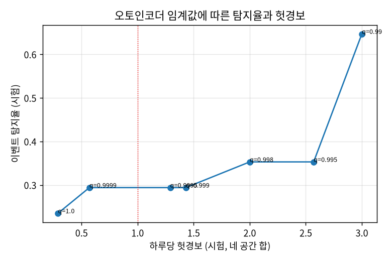

[← 전체 목차](../README.md)

# 과제 4. 이상 탐지

## 해결한 것

1. **정상만 보고 이상을 찾는 모델**로 오토인코더를 학습했다. 최근 1시간을 넣고 다시 그려 보게 하여, 잘 못 그리는 구간을 이상으로 본다. 학습에는 고장이 없는 데이터만 썼다.
2. **경보 기준(임계값)은 검증 기간(고장 없음)의 헛경보 수**로 정했다. 기준을 높일수록 헛경보가 줄고 탐지율도 줄어든다. 오토인코더 기준을 상위 1%에서 최댓값으로 올리면 헛경보는 하루 3.0회에서 0.29회로, 탐지율은 65%에서 24%로 떨어진다(아래 그래프).
3. **규칙 기반 탐지**를 만들어 모델과 비교했다.

   - 급변: 값 하나가 직전 세 값과 다음 값 모두에서 크게 벗어남
   - 값 고정: 세 값이 30분 동안 똑같음
   - 영점 틀어짐: 일정 없는 시간에 CO₂가 평평한데 바깥 공기보다 100ppm 넘게 높음
   - 정상 범위: 직전 7일의 같은 공간·같은 시각 최댓값을 넘음
4. **고장 종류별로 평가**했다. 탐지율, 탐지 지연, 하루 헛경보 수, 종류별 탐지 결과를 아래 표에 냈다.
5. **경보가 어느 센서 때문인지** 가리킨다. 결합 탐지기가 가리킨 원인 센서는 잡은 고장에서 모두 맞았다(100%). 오토인코더 혼자서는 60%였다.

**4번 탐지 성적표** (합성 시험 7일, 고장 17건)

| 탐지기 | 탐지율 (전체 17) | 탐지율 (관측 가능 15) | 평균 지연 | 헛경보/일 | 튄 값 | 값 고정 | 영점 | 냉방 정지 | 환기 정지 |
|---|---|---|---|---|---|---|---|---|---|
| 오토인코더 | 29% | 33% | 218분 | 1.43 | 2/6 | 1/3 | 2/2 | 0/3 | 0/3 |
| 규칙(급변·고정·영점) | 53% | 60% | 84분 | 0.14 | 5/6 | 2/3 | 2/2 | 0/3 | 0/3 |
| 정상 범위(최근 7일) | 41% | 47% | 119분 | 0.14 | 0/6 | 0/3 | 2/2 | 2/3 | 3/3 |
| 예측 오차(심화) | 24% | 27% | 181분 | 0.43 | 0/6 | 0/3 | 2/2 | 1/3 | 1/3 |
| **결합 v2** (오토인코더 높은 기준 + 규칙 + 정상 범위) | **82%** | 93% | 64분 | **0.86** | 5/6 | 2/3 | 2/2 | 2/3 | 3/3 |
| 결합 v3 (v2 + 예측 오차) | 88% | 100% | 62분 | 1.14 | 5/6 | 2/3 | 2/2 | 3/3 | 3/3 |

*측정 조건: 합성 시험 2026-10-05 ~ 10-11, 생성기 v2. 임계값은 모두 검증 기간 헛경보로 정했다. v1 생성기는 냉방 정지가 온도를 올리지 않는 버그가 있었고, 그때 결합 v2 탐지율은 71%였다.*

## 확인 기준

| 기준 | 결과 | 판정 |
|---|---|---|
| 모델과 규칙을 합쳐 이벤트 탐지율 80% 이상 | 결합 v2, 고장 17건 중 14건(82%) | 통과 |
| 헛경보 하루 1회 이하 (전체 공간 합) | 하루 0.86회 | 통과 |
| 모델이 못 잡는 고장과 규칙이 못 잡는 고장을 찾아 이유 설명 | 모델은 값 고정, 규칙은 냉방·환기 정지(아래 생각해 볼 점) | 통과 |

## 산출물

- **탐지 성적표** (모델 / 규칙 / 결합 × 고장 종류): 위 4번 표.
- **임계값에 따른 탐지율·헛경보 변화**: 위 그래프. 경보 기준은 “탐지율”보다 “운영자가 하루에 감당할 알림 수”로 먼저 정하고, 그 안에서 탐지율을 올리는 순서가 맞다.
- **운영 제안**

   - 강의실: 정상 범위 규칙(CO₂ +200ppm, 온도 +1.5℃)으로 시설 담당에게 알린다.
   - 모든 공간: 값 고정·급변·데이터 끊김은 IT(센서 관리) 담당에게 알린다.
   - 영점 틀어짐: 실시간 경보 대신 “새벽 CO₂가 바깥 공기보다 높음” 일일 점검 보고로 보낸다. 잡는 데 2~5시간이 걸려 실시간 알림의 의미가 적다.

## 생각해 볼 점

- **정상 범위의 값에서 멈추면 왜 모델이 못 잡나**: 멈춘 값은 흔들림이 없어 오토인코더가 “조용한 정상”처럼 오히려 더 잘 그려낸다. 값 고정 3건 중 2건을 놓쳤다. 규칙은 “세 값이 똑같다”로 바로 잡는다(지연 29분).
- **규칙이 못 잡는 것**: 냉방·환기 정지 같은 설비 고장이다. 값은 정상적으로 움직이면서 “평소보다 높을” 뿐이라, 평소와 비교하는 정상 범위 규칙과 예측 오차가 잡는다.
- **빈 방에서 환기가 멈추면**: 사람이 없으면 CO₂가 오르지 않아 센서로는 알 수 없다. 바로 알릴 필요도 적다. 다음 사용자가 들어오면 평소보다 빨리 오르므로 그때 잡힌다.
- **정답이 없는 실데이터에서 확인하는 법**: 일부러 만든 고장으로 확인했다. 수집기를 10분 멈추자 데이터 끊김 경보가 정확히 울렸다. 합성 데이터로 학습한 오토인코더는 사무실에서 밤새 476분 울렸는데, 실데이터 분포가 달라서다. 실데이터로 다시 학습해야 한다.
- **남은 사각지대**: 회의실 냉방 정지 1건. 회의실은 평소에도 오후에 28℃ 가까이 올라 +4℃가 평소 범위에 묻힌다. 냉난방 실내기 상태(xflow)를 함께 보면 고장 순간에 바로 알 수 있다. 이 값은 실데이터에서 이미 수집 중이다.
- **관측할 수 없었던 2건**: 라운지 값 고정은 고장 동안 게이트웨이가 끊겨 메시지가 0건이었다. 라운지 튄 값은 5분마다 보내는 센서의 보고 사이 1분에 생겨 기록되지 않았다.

## 심화(B)

- **예측 오차를 이상 점수로 쓰는 탐지기**: 30분 전 예측보다 크게 높은 상태가 30분 이어지면 경보한다. 혼자서는 24%지만 냉방·환기 정지를 잡아, 결합 v3는 탐지율 88%까지 오른다. 다만 헛경보가 하루 1.14회로 기준을 넘는다. 오토인코더보다는 탐지율이 낮고(24% vs 29%) 헛경보는 적다(0.43 vs 1.43).
- **영점 틀어짐 전용 방법**: “사람이 없는 시간의 CO₂는 바깥 공기와 비슷해야 한다”를 이용했다. 일정 없는 시간에 CO₂가 평평한데 바깥 공기보다 100ppm 넘게 높으면 경보한다. 영점 틀어짐 2건을 모두 잡았다.
