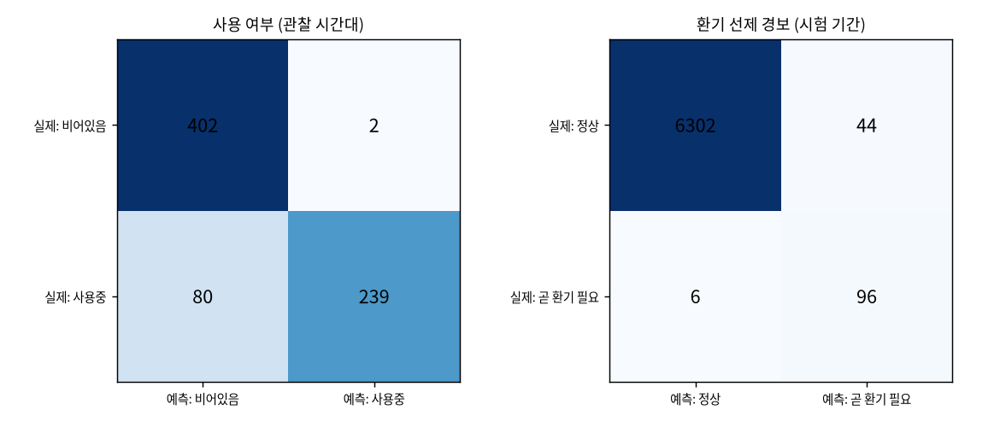

[← 전체 목차](../README.md)

# 과제 5. 상태 추정

## 해결한 것

1. **정답을 정의했다.**

   - 사용 여부: 수업 시간표·회의실 예약으로 정답을 만들고, 공간마다 시험 기간 평일 이틀(9~18시)을 직접 관찰한 것으로 정답 품질을 먼저 확인했다. 직접 관찰은 합성 데이터의 실제 인원으로 대신했다. 일정 기반 정답은 22.5%가 틀렸다.
   - 환기 경보: “지금은 1,000ppm 미만이고 30분 안에 1,000ppm 이상이 되는 시점”을 양성으로 봤다. 이미 넘은 시점은 뺐다. 그때는 “미리” 알리는 것이 아니고, 넣으면 모델이 “지금 높으면 경보”라는 쉬운 문제만 배운다.
2. **사용 여부 추정에는 일정을 입력으로 쓰지 않았다.** 정답이 일정에서 나왔는데 입력에도 넣으면, 모델이 “일정에 있으면 사용”이라는 지름길을 외운다. 점수는 높게 나오지만 정작 찾고 싶은 노쇼와 휴강을 하나도 못 찾는다.
3. **분류 모델 2종을 학습했다.** 사용 여부는 GBDT(센서값만), 환기 경보는 MLP다. 환기 경보의 경보 기준(0.83)은 검증 기간에서 정했다.
4. **불균형을 다뤘다.** 환기 경보 양성은 전체의 1.6%라서, 아무 경보도 안 내도 정확도가 98.4%다. 그래서 정확도 대신 재현율(실제 양성 중 잡은 비율)과 macro-F1(두 분류의 F1 평균)로 평가했다.
5. **단순 규칙과 비교했다.** 사용 여부는 “최근 15분 CO₂가 30ppm 이상 올랐으면 사용중”, 환기 경보는 “지금 CO₂가 850ppm 이상이면 경보”다(아래 표).

**사용 여부** (직접 관찰한 시간대 723칸)

| 방법 | 정확도 | F1 | 빈 방을 사용중으로 본 비율 |
|---|---|---|---|
| 일정 그대로 (정답 품질 확인) | 0.775 | 0.749 | 21.5% |
| 규칙: 15분 CO₂ +30ppm | 0.784 | 0.693 | 3.2% |
| **분류 모델 (센서만)** | **0.887** | **0.854** | **0.5%** |

**환기 선제 경보** (시험 기간 6,448칸, 양성 1.6%)

| 방법 | 정확도 | 재현율 | 정밀도 | macro-F1 |
|---|---|---|---|---|
| 항상 ‘경보 없음’ | 0.984 | 0 | — | 0.496 |
| 규칙: 지금 CO₂ ≥ 850 | 0.987 | 0.686 | 0.565 | 0.806 |
| **분류 모델 (기준 0.83)** | 0.992 | **0.941** | 0.686 | **0.895** |
| 과제 3 예측 모델 (30분 안 최대 예측 ≥ 1,000) | 0.994 | 0.839 | 0.796 | 0.907 |

**혼동 행렬** (분류 모델, 행 = 실제, 열 = 모델 판단)

| 사용 여부 | 비어있음으로 판단 | 사용중으로 판단 |
|---|---|---|
| 실제 비어있음 | 402 | 2 |
| 실제 사용중 | **80** | 239 |

| 환기 경보 | 경보 안 함 | 경보 |
|---|---|---|
| 실제 음성 | 6,302 | 44 |
| 실제 양성 | 6 | 96 |

*측정 조건: 합성 시험 2026-10-05 ~ 10-11. 환기 경보 기준은 검증 기간에서 정했다.*

## 확인 기준

| 기준 | 결과 | 판정 |
|---|---|---|
| 사용 여부: 직접 관찰 기준 정확도·F1, 빈 방→사용중 오류율, 단순 규칙보다 좋음 | 정확도 0.887, F1 0.854(규칙 0.693), 빈 방→사용중 0.5% | 통과 |
| 환기 경보: 재현율 85% 이상, 단순 규칙보다 macro-F1 높음 | 재현율 94.1%, macro-F1 0.895(규칙 0.806) | 통과 |
| 혼동 행렬로 가장 많이 헷갈리는 경우 설명 | 아래 생각해 볼 점 | 통과 |

## 산출물

- **두 분류기의 성적표와 혼동 행렬**: 위 표.
- **일정 기반 정답과 직접 관찰의 차이**: 일정 기반 정답은 22.5%가 틀린다. 휴강이 끼어 있던 강의실 A는 “일정=사용, 실제=빈 방”이 81칸이고, 라운지는 일정 없이 쓴 것이 41칸이다.
- **가장 많이 틀리는 상황**: “사용중인데 빈 방”으로 본 경우다(80칸). 그중 16칸이 사람이 막 들어온 직후 15분이다. 라운지는 머무는 시간이 5~40분으로 짧고 인원이 적어 가장 어렵다.

## 생각해 볼 점

- **막 나간 직후와 막 들어온 직후**: 막 들어온 직후가 더 어렵다. 사람이 들어와도 CO₂가 오르기까지 1.5~8분이 걸리고, 5분 평균이 그 변화를 더 늦춘다. 막 나간 직후는 CO₂가 아직 높아도, 모델이 “떨어지는 속도”를 보고 구분한다. 그래서 빈 방을 사용중으로 본 경우는 2칸(0.5%)뿐이다.
- **큰 강의실을 적은 인원이 쓸 때**: 같은 인원이라도 방이 클수록 CO₂가 느리게 오른다. 그래서 방이 클수록 구별할 수 있는 최소 인원이 커진다. 이 한계를 숫자로 재지는 않았다.
- **환기 경보의 재현율 vs 정밀도**: 재현율을 우선했다. 놓치면 수업 중 머리 아픈 상태가 되고, 헛경보는 창문을 조금 일찍 여는 비용이다. 다만 정밀도가 0.69라 경보 3번 중 1번은 헛경보다. 이게 더 낮아지면 사람들이 알림을 무시하게 되므로, 경보는 30분에 한 번으로 묶어 보낸다(과제 8).
- **예측 모델로 대신할 수 있나**: 과제 3 예측 모델로 판단하면 macro-F1은 비슷하게 높지만(0.907) 재현율이 84%로 기준 아래다. 서비스에서는 둘 다 계산해, 분류기는 경보에, 예측은 “몇 분 뒤”를 알려 주는 데 쓴다.

## 심화(B)

- **처음 보는 공간**: 한 공간을 학습에서 빼고 시험했다. 강의실 A·B와 회의실은 F1 0.79~0.90으로 바로 쓸 만하다. 라운지는 0.58로 그 공간 데이터가 필요하다.
- **회의실 노쇼와 예약 없는 사용 찾기**: 사용 여부 분류 모델의 판단으로 두 규칙을 만들었다. 노쇼는 “예약 시작 뒤 15분 동안 계속 비어있음”, 예약 없는 사용은 “15분 이상 사용중인데 어떤 예약과도 겹치지 않음”이다. 직접 관찰 대신 합성 데이터의 실제 인원과 비교했다(아래 표). 노쇼는 실제 3건을 모두 잡고 헛경보는 1건으로, CO₂ 상승 규칙(헛경보 3건)보다 절반 아래로 줄었다. CO₂ 규칙이 틀렸던 “직전 회의 바로 뒤” 경우를 모델은 맞혔다. 남은 헛경보 1건은 첫 사람이 12분 뒤에 들어온 회의다.

**노쇼 찾기** (회의실, 검증+시험 2주)

| 규칙 | 예약 | 실제 노쇼 | 노쇼로 판정 | 맞힘 | 놓침 | 헛경보 |
|---|---|---|---|---|---|---|
| **모델 판단, 15분 비어있음** | 27 | 3 | 4 | 3 | 0 | **1** |
| (기존) CO₂ 30분 안 +50ppm 없음 | 27 | 3 | 6 | 3 | 0 | 3 |

**예약 없는 사용 찾기** (검증+시험 2주)

| 공간 | 실제 건수 | 판정 | 맞힘 | 놓침 | 헛경보 |
|---|---|---|---|---|---|
| 회의실 | 1 | 1 | 1 | 0 | 0 |
| 라운지 | 5 | 0 | 0 | **5** | 0 |
| 강의실 A·B | 0 | 0 | 0 | 0 | 0 |

*측정 조건: 합성 데이터, 시험 주간에 노쇼가 2건뿐이라 모델 학습에 쓰지 않은 검증 주간을 합쳐 2주(09-28 ~ 10-11)로 봤다. 정답은 실제 인원(직접 관찰 대신).*

라운지에서 놓친 5건은 모두 저녁이나 이른 아침에 2~3명이 20~40분 머문 경우다. 라운지(180m³)는 넓어서 2~3명으로는 CO₂가 거의 오르지 않는다. 헛경보를 더 줄이려면 노쇼 알림을 두 단계(15분 비어있음 → 확인 요청, 30분 → 예약 해제)로 두고, 넓은 공간에는 동작 감지(PIR) 센서를 함께 쓰는 것이 좋다. 다만 노쇼가 3건뿐이라 표본이 작다.
