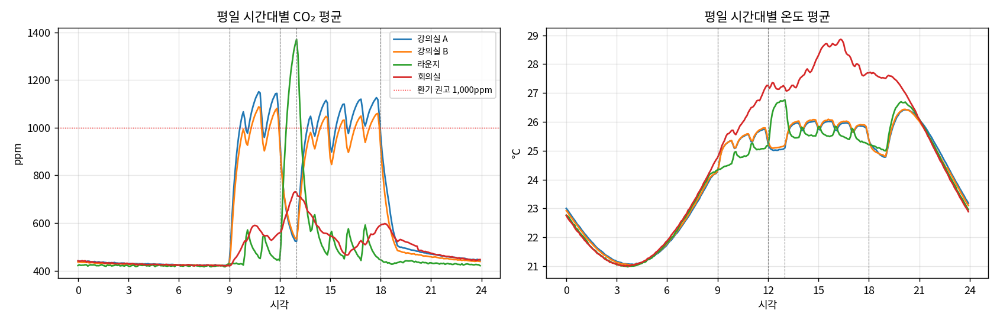
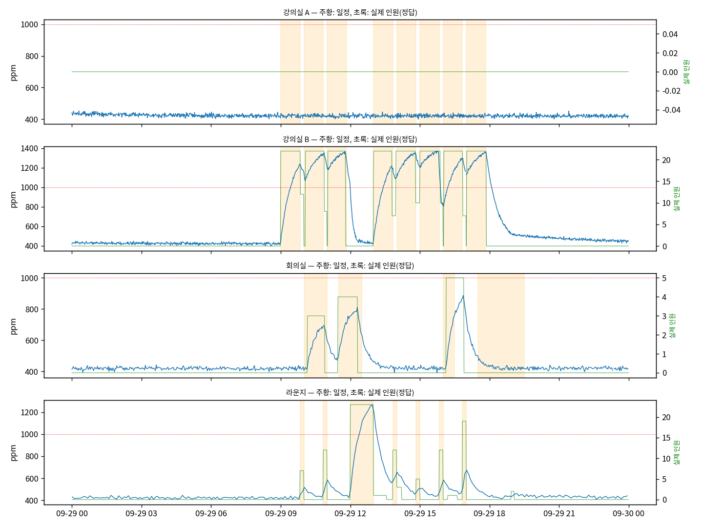
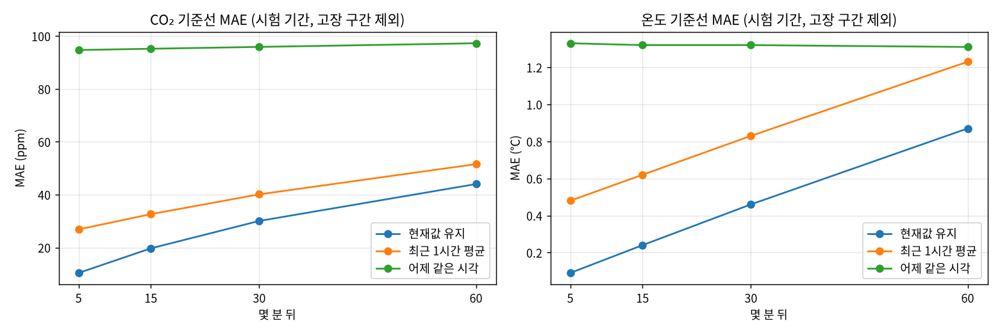

# 과제 2. 데이터 진단서와 기준선

> **측정 조건**
> - 데이터: 합성 데이터(`sim/generate.py`, seed 42). 실데이터는 2026-10-20부터 쌓기 시작해서 3주가 차면 같은 코드로 다시 잰다.
> - 기간: 2026-08-31 ~ 10-11 (6주, 1분 원본 → 5분 칸)
> - 분할: 학습 08-31~09-27, 검증 09-28~10-04, **시험 10-05~10-11**
> - 계산: Jetson Orin Nano 8GB, 25W 모드, CPU
> - 코드: `~/work/ts/prep.py`(공통 전처리), `diagnose.py`, `baselines.py`

## 1. 정제 규칙

| 문제 | 규칙 | 이유 |
|---|---|---|
| 물리적으로 불가능한 값 (0ppm, 65535ppm, -40℃, 60℃) | **CO₂ 300~5,000ppm, 온도 -10~50℃, 습도 0~100% 밖은 결측으로 바꾼다** | 외기 CO₂가 약 420ppm이라 실내에서 300ppm 아래는 나올 수 없다. 이 값을 그대로 평균에 넣으면 5분 칸 하나가 수백 ppm 틀어진다. 지우지 않고 결측으로 두면 아래 보간 규칙이 처리한다 |
| 튄 값·값 고정·영점 틀어짐 | **여기서 지우지 않는다** | 범위 안의 고장 값은 정상 값과 구별하려면 시간 맥락이 필요하다. 이건 과제 4 탐지기의 몫이다. 정제 단계에서 지우면 탐지기를 평가할 수 없다 |
| 센서마다 다른 기록 주기 (강의실 1분, 회의실 2분, 라운지 5분) | **5분 칸 (t-5분, t] 평균. 칸 이름은 끝 시각 t** | 가장 느린 라운지 센서도 칸마다 1건이 들어간다. 칸 이름을 끝 시각으로 두면 시각 t의 값은 t까지의 데이터만 써서 예측에 미래가 섞이지 않는다 |
| 짧은 결측 (15분 이하) | **시간 선형 보간. 보간했다는 표시(`*_imp`)를 남긴다** | 15분 동안 CO₂는 보통 직선에 가깝게 변한다(반응 시간 1~6분, 아래 3절). 보간한 값은 평가 정답에서 뺀다 |
| 긴 결측 (15분 초과, 최장 350분) | **결측으로 둔다. 그 구간을 입력이나 정답에 쓰는 샘플은 뺀다** | 몇 시간을 직선으로 메우면 수업·점심 같은 큰 변화가 사라진 가짜 데이터가 된다 |
| 시각 (실데이터) | **네트워크 서버 수신 시각(`nsTime`)을 쓴다** | 실데이터에서 게이트웨이 한 대의 시계가 약 295초 빨랐다(과제 1 보고서 참고) |

**분석 간격: 5분.** 예측 목표가 "60분 앞까지 5분 간격"이고, 가장 느린 센서 주기가 5분이다. 1분을 그대로 쓰면 라운지·회의실은 칸의 50~80%가 비어서 결측 처리가 대부분이 된다. 또 5분 평균은 측정 잡음(CO₂ σ 8ppm)을 √5배쯤 줄인다. 대신 1~2분짜리 반응은 흐려지는데, 반응 시간 중앙값이 1.5~8분이라 5분 칸 1~2개 안에 잡힌다.

**분할: 시간순.** 학습 4주 → 검증 1주 → 시험 1주로 나눴다. 무작위로 섞으면 안 되는 이유는 세 가지다.
- 5분 칸끼리 강하게 이어져 있다. 섞으면 시험 칸 바로 앞뒤 칸이 학습에 들어가서, 모델이 "옆 칸을 외워" 실제보다 훨씬 좋게 나온다.
- 60분 뒤를 맞히는 문제인데, 섞으면 학습 샘플의 정답(미래)이 시험 샘플의 입력과 겹친다.
- 실제 운영에서는 항상 과거로 학습하고 미래를 예측한다. 평가도 같아야 한다.

**정규화**: 평균·표준편차를 학습 기간의 실제 관측값(보간 제외)으로만 계산했다(`prep.norm_stats`). CO₂ 평균 524ppm·표준편차 213ppm, 온도 24.3℃·2.8℃, 습도 56.7%·5.9%다.

## 2. 데이터 진단

### 결측률과 제거한 이상값

| 공간 | 기록 주기 | 메시지 수신률 | 5분 칸 결측 (보간 전 → 후) | 제거한 이상값 (CO₂ / 온도) | 결측 구간 수 (15분 이하 / 초과) | 최장 결측 |
|---|---:|---:|---:|---:|---:|---:|
| 강의실 A | 1분 | 98.9% | 0.8% → 0.6% | 33 / 26 | 19 / 1 | 350분 |
| 강의실 B | 1분 | 99.1% | 0.6% → 0.4% | 26 / 33 | 25 / 1 | 225분 |
| 회의실 | 2분 | 99.2% | 0.6% → 0.4% | 12 / 17 | 26 / 1 | 215분 |
| 라운지 | 5분 | 98.3% | 1.8% → 1.2% | 4 / 7 | 48 / 3 | 320분 |

- 짧은 결측은 대부분 게이트웨이 끊김(2~12분, 네 공간에서 동시에 발생)이고, 보간으로 거의 사라진다.
- 남는 결측은 공간마다 1~3번 있는 몇 시간짜리 끊김뿐이다.
- 라운지는 5분 주기라 메시지 하나만 빠져도 5분 칸이 통째로 빈다. 그래서 결측률이 다른 공간의 2~3배다. **기록 주기가 긴 센서일수록 유실 한 건의 영향이 크다.**

### 평일 시간대별 패턴 (학습 기간)

- **수업이 그대로 보인다.** 강의실은 9시에 420→1,000ppm까지 오르고, 50분 수업과 10분 쉬는 시간마다 톱니 모양이 생긴다.
- **점심이 보인다.** 12시에 강의실은 떨어지고(1,100→530ppm), 같은 시각 라운지가 1,370ppm까지 오른다. 사람이 강의실에서 라운지로 옮겨 간 것이 CO₂에 그대로 찍힌다.
- **퇴실이 보인다.** 18시 이후 강의실은 1시간 안에 500ppm으로 떨어진다.
- 강의실의 시간대 평균이 10~11시, 14~17시에 1,000ppm을 넘는다. **안내문의 문제("수업 중 환기 권고선 초과")가 데이터에서도 확인된다.**
- 온도는 냉방 가동 시간(08:30~19:00)에 24℃ 근처로 묶이고 인원에 따라 +1~2℃ 오른다. 회의실은 인원 대비 공간이 작아 오후에 28℃를 넘는다. 냉방이 꺼지는 19시에는 실내가 외기 쪽으로 다시 올라갔다가 밤새 식는다.

### 일정 변화 뒤 CO₂ 반응 시간 (1분 원본)

기준은 사건 직전 10분 평균이다. 상승은 +50ppm, 하강은 -100ppm에 처음 닿는 시간을 쟀다.

| 공간 | 사건 | 사건 수 | 반응 없음 | 반응 시간 중앙값 (25~75%) |
|---|---|---:|---:|---|
| 강의실 A | 수업 시작 09:00 | 30 | 2 | **1.5분** (1.0~3.0) |
| 강의실 A | 점심 시작 | 30 | 2 | 5.0분 (3.0~6.0) |
| 강의실 A | 오후 수업 13:00 | 30 | 4 | 2.0분 (1.0~5.5) |
| 강의실 A | 퇴실 | 30 | 3 | 6.0분 (3.0~7.5) |
| 강의실 B | 수업 시작 09:00 | 30 | 3 | 3.0분 (1.0~4.5) |
| 라운지 | 점심 | 29 | 0 | 1.0분 |
| 회의실 | 회의 시작 | 90 | 19 | **8.0분** (4.0~10.0) |

- **강의실은 오를 때 빠르고(1.5~3분) 내려갈 때 느리다(5~6분).** 사람이 들어오면 배출량이 바로 늘지만, 나간 뒤에는 환기로 천천히 빠져나가기 때문이다.
- **회의실이 가장 느리고 들쭉날쭉하다(중앙값 8분).** 예약 시각보다 늦게 오는 경우가 많고(지각 최대 12분), 인원도 2~8명으로 들쭉날쭉하다.

### 일정과 실제가 어긋난 날

| 종류 | 찾는 방법 | 결과 | 정답과 비교 |
|---|---|---|---|
| 휴강 (시간표엔 수업이 있는데 아무도 오지 않음) | 9~18시 CO₂ 상승 폭(상위 10% - 하위 5%)이 150ppm 미만 | 5일 찾음: 강의실 A 09-29·10-09, 강의실 B 09-15·10-01·10-06 | **5일 모두 실제 인원 0명. 놓친 날 없음** |
| 회의실 노쇼 | 예약 시작 후 30분 안에 CO₂가 +50ppm 오르지 않음 | 예약 90건 중 19건을 노쇼로 추정 | 진짜 노쇼 10건은 모두 잡았다. **사용한 회의 9건을 노쇼로 오판했다** |

- 위 그래프의 날(09-29)이 바로 강의실 A 휴강일이다. 시간표(주황)에는 수업이 있는데 CO₂는 하루 내내 420ppm이다.
- **회의실 오판 9건은 원인이 하나다.** 직전 회의가 막 끝나 CO₂가 이미 높은 상태(시작 직전 중앙값 **719ppm**, 진짜 노쇼는 423ppm)에서 다음 회의가 시작된 경우다. 환기로 빠지는 양과 새로 들어온 사람이 내뿜는 양이 비슷해서 CO₂가 오르지 않는다. **"CO₂가 올랐나"보다 "환기만 있을 때보다 덜 떨어졌나"를 봐야 한다.** 과제 5 사용 여부 추정에서 개선할 점이다.

## 3. 기준선 성능

모든 방법을 **같은 평가 지점**에서 쟀다(`report/eval_points.csv`, 과제 3 이후 모델도 이 지점을 그대로 쓴다). 평가 지점의 조건은 이렇다.
- 시험 기간의 5분 칸이다.
- 지금 값과 h분 뒤 정답이 모두 실제 관측이다(보간 아님).
- 어제 같은 시각 값이 있다.
- 4시간 전부터 h분 뒤까지 고장 구간이 없다(고장은 과제 4에서 따로 평가).

### 시험 기간 MAE (모든 시간대)

| 대상 | 몇 분 뒤 | 현재값 유지 | 최근 1시간 평균 | 어제 같은 시각 | 평가 지점 수 |
|---|---:|---:|---:|---:|---:|
| CO₂ (ppm) | 5 | **10.4** | 26.9 | 94.7 | 6,277 |
| | 15 | **19.7** | 32.6 | 95.2 | 6,231 |
| | 30 | **30.1** | 40.1 | 95.9 | 6,168 |
| | 60 | **44.0** | 51.6 | 97.3 | 6,046 |
| 온도 (℃) | 5 | **0.09** | 0.48 | 1.31 | 6,275 |
| | 15 | **0.24** | 0.62 | 1.31 | 6,229 |
| | 30 | **0.46** | 0.83 | 1.31 | 6,166 |
| | 60 | **0.87** | 1.23 | 1.30 | 6,044 |

### 평일 9~18시만 (실제로 예측이 필요한 시간)

| 대상 | 몇 분 뒤 | 현재값 유지 | 최근 1시간 평균 | 어제 같은 시각 |
|---|---:|---:|---:|---:|
| CO₂ (ppm) | 5 | **24.5** | 89.8 | 282.8 |
| | 60 | **140.9** | 165.7 | 278.2 |
| 온도 (℃) | 5 | **0.09** | 0.42 | 0.98 |
| | 60 | **0.44** | 0.67 | 0.87 |

### 공간별 CO₂ 60분 MAE (시험)

| 공간 | 현재값 유지 | 최근 1시간 평균 | 어제 같은 시각 |
|---|---:|---:|---:|
| 강의실 A | 46.5 | 56.5 | 72.7 |
| 강의실 B | 64.9 | 81.2 | **228.6** |
| 회의실 | 21.3 | 22.6 | 30.5 |
| 라운지 | 46.4 | 50.0 | 70.6 |

## 4. 해석

**가장 강한 기준선은 "현재값 유지"다.** 모든 예측 시점, 모든 공간, CO₂와 온도 모두에서 1등이다.
- CO₂와 온도는 몇 분 사이에는 크게 바뀌지 않는다. 그래서 지금 값이 가장 좋은 추정치다.
- "최근 1시간 평균"은 같은 정보를 쓰면서 일부러 과거로 끌려가는 방법이다. 수업 중처럼 계속 오르는 구간에서는 항상 늦는다. 5분 뒤 CO₂ 오차가 2.6배나 크다.
- 오차는 예측 시점이 멀수록 커진다. 5분 10ppm → 60분 44ppm이다. 평일 낮만 보면 60분 오차가 141ppm까지 커지는데, 수업 시작·점심·퇴실처럼 지금 값만 봐서는 알 수 없는 변화가 이 시간에 몰려 있기 때문이다. **과제 3 모델이 이겨야 할 지점이 바로 여기다.**

**"어제 같은 시각"이 가장 약한 이유**는 어제와 오늘이 다른 날이 많아서다.
- 월요일의 어제는 일요일이다. 월요일 낮 60분 오차가 387ppm이다.
- 어제가 휴강이었거나, 오늘이 휴강이면 통째로 틀린다. 강의실 B는 시험 주 화요일(10-06)이 휴강이라 수요일 예측이 크게 틀렸고, 공간 평균 오차가 229ppm까지 올랐다.
- 반대로 **시간표가 매일 같은 강의실에서 평일이 이어질 때는 강하다.** 시험 주 목요일 평일 낮 60분 CO₂ 오차를 보면 어제 같은 시각이 **60.7ppm**으로, 현재값 유지(97.3ppm)보다 좋았다. 미래의 수업 시작·종료를 "어제의 기억"으로 미리 알기 때문이다.
- 즉 **어제 같은 시각은 "일정이 반복되는 공간"에서만 강하다.** 이것은 과제 3의 힌트이기도 하다. 반복되는 일정을 어제 값으로 대신 쓰지 말고, **일정표를 직접 입력으로 넣으면** 두 방법의 장점을 합칠 수 있다.

**공간별 차이**: 회의실은 60분 오차가 가장 작다(21ppm). 다만 이건 예측을 잘해서가 아니라 대부분 비어 있어서 CO₂가 평평하기 때문이다. 사용 중인 시간만 보면 회의실이 가장 어렵다. 예약 시각과 실제 시작이 어긋나고(반응 중앙값 8분), 노쇼가 15%다. 과제 3에서 사용 중 시간만 따로 잰다.

**과제 3 목표**: 60분 뒤 CO₂ MAE를 현재값 유지(44.0ppm)보다 30% 이상 작은 **30.8ppm 이하**로, 온도는 0.87℃보다 작게 만든다. 같은 평가 지점에서 비교한다.

## 생각해 볼 점에 대한 답

- **고장이 섞인 구간은 학습에 넣어야 할까?** 예측 모델 학습에서는 **뺀다.** 고장 값은 실제 공기 상태가 아니라서, 넣으면 모델이 "가끔 값이 이유 없이 수백 ppm 뛴다"를 배워 정상 구간 예측까지 흐려진다. 합성 데이터는 고장이 시험 주에만 있어 학습에는 원래 없다. 실데이터에서는 과제 4 탐지기로 고장 구간을 찾아 표시한 뒤 학습에서 뺀다.
- **평가에서는?** 두 가지를 따로 낸다. 예측 성능은 고장 없는 구간에서 잰다(위 표). 고장 구간에서 예측이 얼마나 틀어지는지는 과제 4에서 "예측 오차를 이상 점수로 쓰는" 탐지기 평가에 쓴다. 섞어서 한 숫자로 내면 예측이 나쁜 건지 센서가 나쁜 건지 구별할 수 없다.
